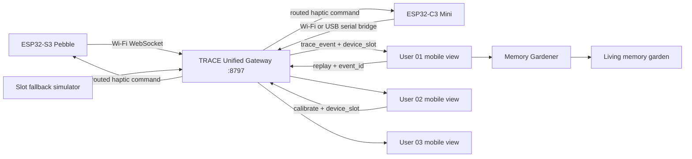

# TRACE · Memory Pebble

[](https://github.com/hupop444/trace-memory-pebble-hackathon/actions/workflows/ci.yml)


> 用一次自然捏压留下当下，并让数字记忆在原来的实体 Pebble 上重新产生触觉回声。


TRACE 是面向千人黑客松现场的完整软硬件交互原型。ESP32-S3 / ESP32-C3 Pebble 采集压力与环境光，统一 WebSocket 网关将真实硬件事件精确路由到三位用户的软件空间；用户补写一句话后，Memory Gardener 将瞬间生长为可回访的记忆。回放始终携带原始 `event_id`，因此触觉反馈会返回最初捕捉它的那块 Pebble。

## 当前能力

- 两种 ESP32 规格共用一套 Wi-Fi 固件与交互协议。
- 压力捏取触发、短振捕捉确认、双段触觉回放。
- 环境光与压力时长作为 Moment 的现场上下文保存。
- 三屏 / 三用户隔离：`device_slot`、`profileId`、事件去重与精确回放。
- 真实设备不足时按槽位补入独立模拟器，演示流程不中断。
- 手机宽度产品界面：认领、生长、花园、年轮、旧日重逢、后来补充。
- 可用的提醒设置、隐私说明与 JSON 记忆导出。
- 参数化 OpenSCAD 外壳、KiCad 传感器板、BOM、打印与视觉资产。

## 系统架构



完整说明见 [系统架构](docs/ARCHITECTURE.md)、[硬件映射](docs/HARDWARE_MAPPING.md) 与 [现场运行手册](docs/DEMO_RUNBOOK.md)。

## 仓库结构

| 路径 | 内容 |
|---|---|
| `software/` | React / TypeScript 手机端、Memory Gardener API、TRACE 软件适配器 |
| `hardware/firmware/` | ESP32-S3 / C3 串口与 Wi-Fi 固件 |
| `hardware/bridge/` | USB Serial ↔ WebSocket 桥 |
| `hardware/tools/` | 三设备网关、模拟器、热点、烧录与协议验收脚本 |
| `hardware/software-integration/` | 权威协议、三屏舞台和交接文档 |
| `hardware/enclosure/` | 可生成与校验的 Pebble 外壳模型 |
| `electronics/` | KiCad 工程、BOM、接线与 Release QA |
| `cad/`, `exports/` | 三尺寸参数化外壳与已验证 STL |
| `renders/`, `references/` | 锁定视觉基线与路演关键帧 |
| `scripts/` | 仓库级安装、验证与启动入口 |

## 快速开始

要求：Windows 11、Node.js 22.13+、Python 3.10+、PowerShell 7；真实硬件模式还需要 Arduino CLI 与 ESP32 board package。

```powershell
pwsh -File .\scripts\setup.ps1
pwsh -File .\scripts\verify.ps1
pwsh -File .\scripts\start-demo.ps1 -Mode Simulator
```

真实硬件模式先复制并填写固件私有配置；启动脚本会在控制台安全询问热点口令，不把口令写进命令历史：

```powershell
Copy-Item .\hardware\firmware\trace_squeeze_wifi\trace_secrets.h.example `
  .\hardware\firmware\trace_squeeze_wifi\trace_secrets.h
pwsh -File .\scripts\start-demo.ps1 -Mode Hardware
```

打开：

- 软件：`http://127.0.0.1:3000/`
- 三屏舞台：`http://127.0.0.1:8789/software-stage.html`
- 网关状态：`http://127.0.0.1:8796/status`
- 统一软件 WebSocket：`ws://127.0.0.1:8797/trace`

## 核心事件契约

只有 `type=trace_event` 且 `trigger=squeeze` 才能创建 Moment：

```json
{
  "type": "trace_event",
  "trigger": "squeeze",
  "event_id": "device-id-sequence",
  "device_id": "trace-pebble-01",
  "device_slot": 1,
  "captured_at": "2026-08-30T00:00:00.000Z",
  "pressure": 0.78,
  "duration": 620,
  "light": 0.42
}
```

回放使用原始事件标识，不根据当前页面猜测设备：

```json
{ "type": "replay", "event_id": "device-id-sequence", "request_id": "uuid" }
```

权威字段与验收标准见 [`TEACHER_SOFTWARE_CONTRACT.md`](hardware/software-integration/TEACHER_SOFTWARE_CONTRACT.md)。

## 安全与隐私

- API Key 只从服务端环境变量读取，禁止使用 `NEXT_PUBLIC_` 前缀。
- Wi-Fi 私密值只放在被 Git 忽略的 `trace_secrets.h`。
- 现场演示账号是固定展示数据，不代表演讲者真实生活数据。
- `node_modules`、编译缓存、下载工具链和重复 ZIP 不进入源码历史。
- 大型交付包应作为 GitHub Release 资产发布。

参见 [SECURITY.md](SECURITY.md)。开发与提交约定见 [CONTRIBUTING.md](CONTRIBUTING.md)。

## 来源与同步

软件产品逻辑同步自 [`mamamaannie/trace-memory-pebble`](https://github.com/mamamaannie/trace-memory-pebble) 的 `main@2a990af`，并叠加本仓库的三设备网关、真实设备状态、传感上下文、request-id ACK、精确回放与校准超时处理。

## 验证状态

- `software`: ESLint 与 production build 通过。
- `hardware bridge`: 串口桥可连接 COM 设备并自动重试。
- `gateway`: 三槽位映射、断线重连、去重、回放与校准协议测试覆盖。
- `CAD`: 12 个 STL 已验证 `watertight=true`、单组件、无退化三角形。

本仓库当前未附带开源许可证；除非权利人另行授权，默认保留全部权利。
